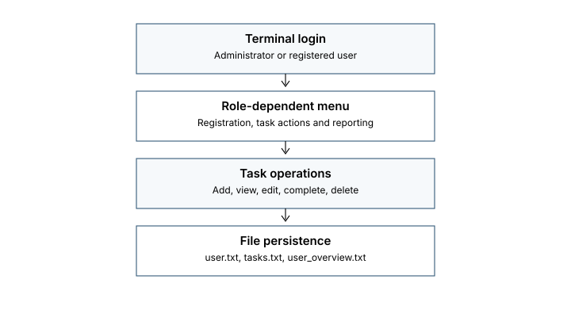

# Designing and Evaluating a File-Based Task Management Application

**A static code study of a Python command-line workflow**

**Amogelang R. Pelo**

## Abstract

I examine the architecture, data handling and operational limitations of a Python command-line task management application developed as a software engineering project. The source implements user registration and login, task assignment, viewing and editing, task completion, deletion and the generation of summary statistics through functions operating on local text files. This paper analyses the available program and its supporting repository files using a structured static review of functions, input validation, persistence and access control. It does not claim the program was executed or empirically tested in a production environment.

My review identifies a coherent educational implementation of menu-based procedural programming and file handling, alongside important limitations. In particular, the application stores registered passwords in plain text, parses records through manual comma splitting, and contains branches where the task selected by a user is not necessarily the only task modified. The project also lacks automated tests that could verify behaviour after changes. I discuss these findings as properties visible in the source code and propose an incremental path from a teaching prototype to a more robust local application.

**Keywords:** Python; task management; static code analysis; file-based persistence; authentication; software quality; maintainability.

## 1. Introduction

Task management systems translate user intentions into persistent records: who must perform an activity, what is required, when it is due and whether it is complete. Even a small command-line tool has to coordinate user interaction, input validation, data storage and consistency of state. These requirements make a task manager a useful case study of the transition from individual programming functions to a coherent software system (Sommerville, 2016).

The source project, referred to in its interface as *TaskFlow*, is written in Python. It presents different menus to administrators and ordinary users and relies primarily on `user.txt` and `tasks.txt` for storing data. The repository also preserves an original Python source file alongside the current implementation (Pelo, n.d.).

My research question is: **How does the program organise a file-based task management workflow, and which design choices most limit its reliability, security and maintainability?** I approach this as a project-based static code study rather than an empirical usability or performance experiment.

The distinction matters. Source inspection can establish that a conditional branch, function call or file operation is present. It can also identify logical inconsistencies. Without a formal test harness and executed scenarios, however, it cannot establish the frequency of failures, an achieved reliability rate or successful deployment under realistic workloads.

## 2. Conceptual and technical framework

### 2.1 Program structure and responsibilities

Procedural design divides behaviour into functions that perform distinct operations. The source defines functions such as `register_user`, `add_task`, `view_all_tasks`, `view_my_tasks`, `delete_task`, `generate_reports` and `statistics`. The main program authenticates a user and dispatches choices through a repeating menu.

This separation has educational benefits: an individual function can be read and reasoned about in isolation, and input is processed through identifiable branches. Nevertheless, most functions combine user prompts, business rules, file parsing and output formatting. The result is relatively tight coupling. Testing a data operation without simulated keyboard input or file-system state would therefore require refactoring (Sommerville, 2016).

### 2.2 Persistence and record structure

A plain text file can persist small data collections without introducing a database server. The project writes comma-separated fields to the filesystem and reconstructs records with `split(",")`. This illustrates a simple persistence mechanism, but it delegates record structure and integrity to the program's own string manipulation.

The Python standard library provides a `csv` module that handles quoting and field delimiters more systematically than manually splitting strings (Python Software Foundation, n.d.-a). Where an application needs consistent updates across related records, transactions and structured storage, SQLite offers a more suitable next step through Python's `sqlite3` interface (Python Software Foundation, n.d.-b).

### 2.3 Authentication and authorisation

Authentication establishes which user is attempting to operate the application; authorisation controls which operations and records that identity may access. These responsibilities must be distinguished. A menu may hide an administrative function without enforcing record-level permission inside every operation.

Password storage is a separate security concern. OWASP recommends adaptive one-way password hashing rather than storing raw passwords, because access to a password file should not reveal the original secrets (OWASP Foundation, n.d.). The submitted project is therefore best understood as a learning prototype rather than a secure multi-user service.

## 3. Research design and source material

### 3.1 Materials examined

I reviewed the repository's project description and the current Python source code, `task_manager.py`. The folder also contains `task_manager_original.py` and a `.gitignore` file. The primary object of assessment is the current implementation; I did not infer unobserved behaviour from the original file or represent the README as test evidence (Pelo, n.d.).

| Source component | Role visible in project | Basis of review |
|:--|:--|:--|
| `task_manager.py` | CLI interface, workflows and persistence | Static reading of control flow |
| `task_manager_original.py` | Preserved earlier source | Project provenance |
| `README.md` | Short functional description | Scope and context |
| `user.txt`, `tasks.txt` | Runtime files referenced in code | Storage and error-path inspection |
| `user_overview.txt` | Generated report output | Reporting path inspection |

The referenced runtime text files are not included in the project-folder inventory examined for this paper. Their absence from the repository is not proof that they never existed during development. It does mean the behaviour of an empty fresh installation deserves explicit testing.

### 3.2 Static review method

I traced the sequence from startup authentication to menu selection and each principal task operation. Within each function I examined input conditions, file reads and writes, index handling and error branches. I compared the resulting mechanisms against general software engineering principles and official guidance on Python data storage and password handling (Sommerville, 2016; OWASP Foundation, n.d.).

No performance benchmark, load test, penetration test or automated functional test was executed for this paper. I use expressions such as *the code attempts* or *the branch can* where the conclusion follows from source inspection rather than observed runtime output.

### 3.3 Application flow

The system starts by requesting credentials, deciding whether the account is an administrator or user, and entering the appropriate menu. Users may add tasks, view records and, depending on the menu, inspect statistics or make changes. Task information is serialised to the local file system.

<figure class="chart wide"><figcaption>Figure 1. Logical flow reconstructed from the current Python source. The diagram summarises code paths; it is not a measured system trace.</figcaption></figure>

The architecture places interaction and persistence inside the same process. This is workable for teaching basic file operations but limits concurrency, data validation and separation of responsibilities.

## 4. Findings: implemented functionality

### 4.1 Registration and login

The registration function asks for a username and password, verifies that the fields are non-empty, checks maximum length and comma use, and rejects a username already found in `user.txt`. It then confirms the entered values before appending a record to the user file. A successful match at login sets a flag used to present the appropriate menu.

These checks show attention to input quality and duplicate identities. However, the stored record is written as `username,password`, and login compares the submitted password directly against the stored value. Thus passwords are present as recoverable text to anyone with access to the file. The administrator password is read from an environment variable, which avoids embedding that particular secret directly in the program, but it does not correct the regular user's password storage design.

### 4.2 Task creation and retrieval

The `add_task` function collects an assignee, title, description and due date. It requires non-empty values, parses the due date using `datetime.strptime`, and rejects dates earlier than the current day. It then appends a record containing the assignee, fields, creation date and a completion flag.

The program can display all task records and filter for tasks attributed to a particular username. A comma-delimited representation is readable and easy to inspect; however, manually joining and splitting values is brittle if a stored field contains unexpected delimiters or malformed rows. The code checks for comma use, but some branches print an error without returning immediately, so the validation policy is not applied consistently.

### 4.3 Editing and completing tasks

The user-task view displays records with numerical indices and provides options to mark a task complete or edit details. The displayed choice creates an expectation that a single selected task will be updated. In the completion branch, however, the code loops through records and changes each record whose assignee matches the entered username; it does not limit updates to the selected `picked_task`. This is a source-visible logic problem that should be resolved before relying on task status for reporting.

The edit logic also requires further validation of index ownership, allowed fields and completed-task restrictions. The presence of a printed statement saying an already completed task cannot be edited is not by itself a `return` or enforced control path. A robust implementation would make each state transition an explicit data operation with a test.

### 4.4 Deletion and statistics

The program includes deletion and reporting features, including counts of completed, incomplete and overdue tasks. These features extend the software beyond basic create-and-view behaviour. Nevertheless, the delete function modifies the task list within a loop over records, and the summary calculations divide user-specific counts by a total that is not consistently user-specific. The latter can produce misleading percentages and creates a potential division-by-zero path when no records are present.

The statistics and completion logic therefore require verification under empty, single-user and multi-user conditions before the displayed reports can be regarded as dependable operational measures.

## 5. Quality, security and failure-mode assessment

### 5.1 Source-grounded issues

I classified source-visible issues by their likely effect, but these categories are reasoned assessment labels—not measured incident frequencies.

| Area | Source-visible observation | Consequence to test |
|:--|:--|:--|
| Credential storage | Passwords written directly to `user.txt` | Credential exposure |
| Record parsing | Manual `split(",")` on text lines | Malformed field handling |
| Completion | Assignee-matching loop without selected-index check | Unintended bulk status updates |
| Authorisation | Usernames supplied through prompts | Cross-user record integrity |
| Statistics | Global denominator for user counts | Misleading percentages |
| Empty installation | Direct file reads in several paths | Missing-file exceptions |
| Test coverage | No test module in examined folder | Unverified regression behaviour |

### 5.2 Security implications

The most immediate security concern is password storage. OWASP guidance favours adaptive password hashing, with appropriately parameterised algorithms such as Argon2id, rather than recoverable plain text (OWASP Foundation, n.d.). Converting existing raw-password records to secure hashes would require a controlled migration and a verification routine that compares password inputs with hashes rather than stored cleartext.

A second concern is record-level authorisation. Prompting for a username does not prove that a person owns that user's tasks. Account identity should be obtained from the authenticated session and applied consistently to all read, edit and delete operations. Administrative permissions should be checked in the underlying functions, not only through the menu that exposes those functions.

### 5.3 Data integrity implications

Text-file writes can succeed independently without a transaction spanning the whole user operation. The current design also lacks a schema that enforces required fields, unique identifiers or valid status values. SQLite would provide a manageable step toward structured records and transactional updates while remaining suitable for an offline, single-device prototype (Python Software Foundation, n.d.-b).

A migration should preserve task history and avoid silently rewriting original records. The project is most useful as a learning system if changes are introduced incrementally and verified against fixed scenarios.

## 6. Improvement design and validation strategy

### 6.1 Separate concerns

I would divide the current code into three layers: a command-line presentation layer for prompts and displays; service functions for user and task rules; and a repository layer for saving and retrieving records. This would let unit tests exercise task changes without requiring interactive terminal input.

A `Task` model could contain an immutable record identifier, owner identifier, title, description, creation date, due date and state. Functions would accept those values explicitly. Each update would return a clear success or failure result rather than rely on prints distributed across a long function.

### 6.2 Introduce a deliberate test matrix

A useful initial test suite should cover registering a user, refusing duplicate usernames, handling empty files, rejecting invalid dates and commas, adding tasks, selecting a single task for completion, enforcing ownership and verifying report denominators. A regression test should specifically show that marking one task complete leaves every other task unchanged.

| Test scenario | Expected invariant |
|:--|:--|
| Register duplicate account | No second record created |
| Add task with invalid date | Task file unchanged |
| Complete one selected task | Exactly one task record changes |
| Edit another user's task | Operation denied |
| No tasks present | Statistics report zeros without crashing |
| Task title includes delimiter | Storage and retrieval remain consistent |

These are proposed tests, **not completed test results**. The distinction prevents the research paper from presenting a development roadmap as established experimental evidence.

### 6.3 Incremental storage and security changes

I would first build a trusted automated test baseline around the existing text format, then replace manual delimiters with the Python `csv` library or migrate to SQLite. Next I would adopt password hashing and identity-based permissions. Finally, I would document deployment assumptions, error handling and recovery from corrupt files. Each stage should maintain compatibility or provide an explicit migration process.

A future system could introduce a web interface and multi-user collaboration, but expanding the interface before resolving data consistency and authorisation would amplify rather than remove the underlying risks.

## 7. Discussion and conclusion

The program demonstrates a broad range of practical Python fundamentals: functions, conditionals, loops, user input, text-file operations, date handling and menu routing. It also illustrates an important software engineering lesson: adding more functions increases the need for centralised rules, explicit record identity and verifiable state transitions.

My static review finds that the implementation is appropriately understood as an educational task manager rather than a production-ready multi-user system. Its strongest contribution is the end-to-end attempt to connect users, tasks, deadlines and summary reporting. Its principal limitations concern credential handling, reliable identification of the selected record, authorisation and the absence of automated tests.

I would preserve the project as evidence of applied procedural programming while prioritising a small set of corrective changes. Hashing passwords, replacing fragile record parsing, enforcing task ownership, correcting completion logic and introducing unit tests would materially improve the reliability of the application. Claims of security, accuracy or production readiness should be reserved for a later implementation supported by actual test evidence.

## References

OWASP Foundation (n.d.) *Password Storage Cheat Sheet*. Available at: https://cheatsheetseries.owasp.org/cheatsheets/Password_Storage_Cheat_Sheet.html.

Pelo, A.R. (n.d.) *Task Management Workflow: Python source code*. GitHub portfolio. Available at: https://github.com/amopelo-southafrica/Software-Engineering-/blob/main/Applications/task-management-workflow/task_manager.py.

Python Software Foundation (n.d.-a) *csv — CSV File Reading and Writing*. Python documentation. Available at: https://docs.python.org/3/library/csv.html.

Python Software Foundation (n.d.-b) *sqlite3 — DB-API 2.0 Interface for SQLite Databases*. Python documentation. Available at: https://docs.python.org/3/library/sqlite3.html.

Sommerville, I. (2016) *Software Engineering*. 10th edn. Boston: Pearson.
