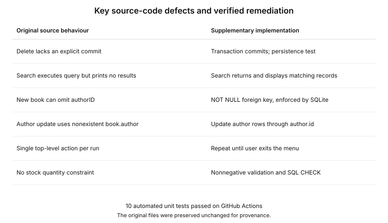
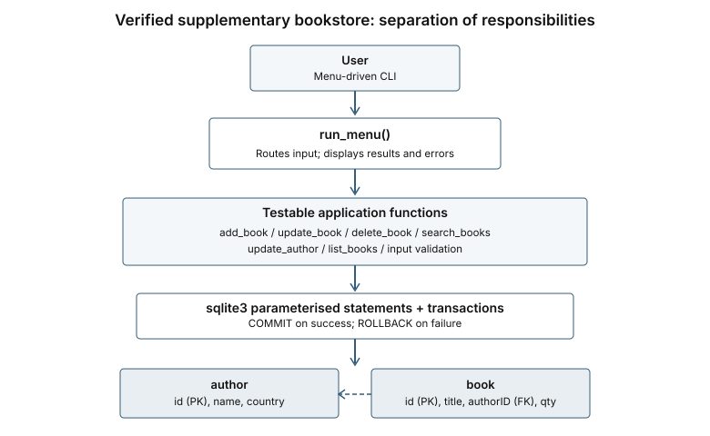

# Designing and Validating a SQLite Bookstore Inventory System

**A source-code audit and tested supplementary implementation of relational CRUD operations**

**Amogelang R. Pelo**

## Abstract

I investigate a Python bookstore-management project that uses SQLite to store book titles, authors and quantities. The original repository contains an earlier submission and a portfolio script, both preserving the author's attempt to create relational book and author tables and implement basic create, read, update and delete operations. The code demonstrates awareness of SQL joins and parameterised statements, but static inspection identifies material problems: the portfolio script accepts a single menu action and exits; newly entered books can have no author reference; deletion does not explicitly commit; search results are not printed; and author-update SQL references fields that do not exist in the declared book table. The earlier version also closes the database inside the initialisation function before its author-table setup is complete.

To distinguish the educational submission from a working system, I developed a **separately labelled supplementary implementation** that retains the book/author concept but introduces explicit referential integrity, validation, transactional writes and a reusable command-line interface. I added a ten-test regression suite covering catalogue seeding, creation, searching, updates, deletion, foreign-key integrity, invalid quantities, parameterised querying and durability across a reopened database connection. The GitHub Actions test run completed successfully, with **all ten tests passing**. The seeded demonstration catalogue contains five books with a combined **144 copies**. These are application test results, not evidence of real bookstore sales or production readiness. I conclude that relational constraints and automated tests substantially improve the credibility of a small database portfolio project, while authentication, concurrent-access handling and operational deployment remain outside the validated scope.

**Keywords:** SQLite; Python; relational databases; CRUD; referential integrity; transactions; automated testing; software engineering.

## 1. Introduction

Inventory systems track identifiable items, record quantities and permit authorised changes to stored data. A bookstore is a manageable setting for exploring these requirements because books and authors form a natural relationship: a title has an author reference, and an author may be associated with more than one title. A useful application must keep these records connected while supporting the everyday operations of adding books, changing quantities, searching records and removing entries (Elmasri and Navathe, 2016).

The educational project studied here consists of two Python scripts named `shelf_track.py` and `shelf_track_original.py`. Both use Python's standard `sqlite3` module and define a `book` table with an identifier, title, author ID and quantity, plus an `author` table with an identifier, name and country. The portfolio script exposes a simple command-line menu (Pelo, n.d.-a).

Designing a menu is not enough, however, to establish an operational inventory application. A successful data-management workflow depends on persistently committed transactions, valid references between related tables and output that tells the operator whether an operation actually succeeded. If a search query runs without displaying its results, the user cannot inspect the matching records. If a deletion is not committed, the change may disappear when the connection closes. These concerns are especially relevant when code is being presented to employers as evidence of software engineering.

My research question is: **Which behaviours can the original bookstore code be shown to implement, which behaviours fail or lack safeguards, and how can a separately tested implementation address those deficiencies?** I answer through source inspection, a documented relational redesign and an automated test suite. The distinction between original work and supplementary development is maintained throughout.

This report is not an evaluation of a commercial bookstore deployment. There are no actual transactions, inventory valuation records, sales histories or concurrent users in the repository. It is a software-design and validation study.

## 2. Literature and software-engineering framework

### 2.1 Relational structure and entity identity

Relational databases store structured rows with keys that identify records and define relationships between tables. In the bookstore example, an author can be represented by an `author` row with a primary key, and a book can reference that author through `authorID`. The stored relationship allows a join to combine a book title with its author's name and country without duplicating all author details inside each book record (Elmasri and Navathe, 2016).

Primary keys provide stable identities independent of presentation fields such as title. Updating or deleting by title can become ambiguous if titles are duplicated or edited, whereas an integer identifier can remain stable. Foreign keys provide a mechanism for preventing a book from referencing an author record that does not exist.

SQLite requires attention to the activation of foreign-key enforcement. Declaring a reference in a table definition does not guarantee that every connection enforces it; the application must enable foreign keys for its connections where appropriate (SQLite, n.d.-a).

### 2.2 Transactional consistency and durability

A transaction groups data changes into a unit that can commit or roll back. Correct handling matters because in-memory changes and durable changes are not necessarily the same thing. A delete statement may execute on a connection but not remain persisted unless the surrounding transaction is committed. SQLite transactions support atomicity and help ensure that failed operations do not leave partial changes (SQLite, n.d.-b).

For an inventory application, the distinction has practical consequences. If an operator receives a successful deletion message but the database reopens with the supposedly removed book still present, the system's behaviour is misleading. Tests therefore need to verify not only the return value of a database operation but also the resulting persisted state.

The supplementary version uses connection context managers for writing operations, ensuring that the transaction is committed on successful exit and rolled back when an exception propagates. It also tests persistence by closing and reopening a file-backed SQLite database.

### 2.3 Parameterised queries and SQL injection

SQL commands must handle user-entered values without interpreting those values as executable SQL syntax. Building statements by concatenating text supplied by a user can permit unintended changes to query meaning. Database APIs provide parameter binding, typically through placeholders, so values are interpreted as data rather than as code (OWASP, n.d.).

Both the original portfolio and the supplementary implementation use parameter placeholders in several database operations. This is a positive feature of the original project. The supplement applies parameterisation consistently to user-supplied search terms, IDs and updates.

The verified implementation constructs the list of update column names only from fixed, internally coded field names. User input becomes parameter values, not dynamically selectable SQL identifiers. This approach allows optional updates without concatenating arbitrary user text into the statement.

### 2.4 Validation and automated verification

Input validation restricts data to the forms that application rules permit. For bookstore inventory, a nonnegative integer quantity is a reasonable invariant; a negative number of copies should not be silently accepted by the catalogue. A title should not consist only of whitespace, and a book's author ID should reference an existing author.

Validation can occur at more than one layer. Python functions can report clear errors before sending a query, while database `CHECK`, `NOT NULL` and foreign-key constraints protect the data even when a calling function contains a defect. Defence in depth is useful because bugs can enter through future code paths that bypass a particular input form (Sommerville, 2016).

Automated tests strengthen these rules by expressing expected behaviour in executable form. A test that merely calls a function is weak if it does not assert the resulting database state. The supplementary tests therefore query actual records and check stored values, row counts and exceptions.

## 3. Materials, scope and methods

### 3.1 Source files reviewed

I examined the portfolio version `shelf_track.py` and the earlier `shelf_track_original.py`, together with the project README. The portfolio version defines database tables near the top of the script, seeds five book records and five author records when their tables are empty, and processes one menu choice based on an early `input` call.

The earlier script takes a more function-oriented approach and includes a repeating menu, but its database setup closes the connection before the subsequent author-table commands. These versions are preserved unchanged in the repository so that a reviewer can distinguish the original submission from later evaluation.

The seed records contain five titles and quantities of **30**, **40**, **25**, **37** and **12**. Their total is **144 copies**. These are illustrative initial values embedded in code rather than observed commercial stock counts.

### 3.2 Static review procedure

I traced the SQL schema definitions, seed statements, menu choices, update paths, search and delete logic, and use of `commit()`. I compared the column names referenced in SQL with the actual columns declared in the tables. I also inspected what happens when a lookup returns no row and whether the code keeps executing after such a result.

The resulting audit is based on source-visible logic. Where execution could depend on database state, I describe the likely failure mechanism and the circumstances that would trigger it rather than inventing a runtime log that was never captured.

### 3.3 Supplementary implementation and testing

I added `shelf_track_verified.py` as a distinct, clearly labelled **supplementary implementation**, not a retroactive rewriting of the student's original submission. It exposes testable functions for schema creation, seeding, listing, searching, adding, updating and deleting books, and editing authors.

The new module is imported without automatically opening or writing a database. Its `main()` function creates the connection and starts the menu only when run as a program. This separation allows tests to call application functions directly without simulating a full terminal session.

Ten unit tests use Python's `unittest` module. Most employ an isolated in-memory SQLite database. The durability test uses a temporary file-backed database and reopens it after deletion. The suite is run through a GitHub Actions workflow using Python 3.12 and the standard library.

## 4. Findings from the original code audit

### 4.1 Relational schema is present but insufficiently constrained

The original script creates a `book` table with an integer primary key, title, author ID and quantity. It also creates an `author` table with ID, name and country. This demonstrates a correct high-level understanding that authors should be stored separately from books and joined when needed.

However, the original `book.authorID` is a plain integer without a declared foreign key or `NOT NULL` constraint. The book-insertion menu asks for a title and quantity but does not ask for an author ID. It then executes an insert that supplies only those two fields.

The result is an application path capable of adding records with no author reference. Later, the view-all query uses an inner join with the author table. A book with a missing author ID will not appear in that joined listing, creating a possible inconsistency between the existence of a record and what the user sees.

This is a source-visible design defect, not merely a matter of presentation. It demonstrates why relational integrity should be enforced at insertion, not assumed by later queries.

### 4.2 Menu lifecycle

The portfolio script prints a menu once and reads a single numeric choice into `menu`. Its conditionals then process that selected branch, after which the script reaches the end. The original version includes a loop but has other setup problems.

A database console can legitimately be a one-command program, but the menu's wording suggests a continuing interactive management system. In that context, allowing one action per process execution is a usability limitation. The supplementary program uses a repeating menu that exits only when the operator chooses zero.

### 4.3 Delete and search behaviour

The portfolio code's delete branch executes a `DELETE FROM book WHERE title = ?` statement and prints a deletion message. It does **not** execute an explicit `db.commit()` in that branch. In a transactional SQLite connection, such an uncommitted write is not a reliable persistent deletion.

The search branch executes a `SELECT title FROM book WHERE title = ?` statement but has no accompanying `fetchone`, `fetchall` or print operation. The query therefore does not produce a visible answer for the operator. A program can execute correct SQL and still fail its functional user requirement.

The supplementary version corrects both behaviours. Deletion occurs inside a committed transaction, and search produces a collection of row data that the CLI formats and prints. It also uses stable book IDs for modification and deletion rather than title strings.

### 4.4 Update and author-management defects

The portfolio script's author-management branch executes a join referencing `author.author_id`. The declared author table contains `id`, not `author_id`. The branch then executes another query, but the first invalid statement would already fail when reached.

Further down, the author-name and country update paths execute statements such as `UPDATE book SET author = ?`, although `book` has no column named `author`. These are direct schema-query mismatches. They are likely to cause SQLite operational errors instead of updating author records.

The book-update branch also prints `Book not found` when the initial search has no result, but then continues to ask for replacements and may refer to `result[0]` or `result[1]`. If the operator leaves fields blank, a missing result could then cause a Python indexing error. A robust flow should terminate the update attempt when no target record exists.

### 4.5 Positive features retained

The source is not without merits. It creates separate book and author tables, uses a relational join for the display-all command, seeds example data and employs SQL parameter placeholders in key user-driven operations. The menu also indicates an attempt to make functionality understandable to a non-programmer.

I regard these features as a valid educational starting point. The defects show the difference between expressing CRUD intentions and verifying that all CRUD paths work reliably. A portfolio audit should acknowledge both the implemented concepts and their limitations.

<figure class="chart wide"><figcaption>Figure 1. Selected defects identified through static code review and their treatments in the independently developed supplementary implementation.</figcaption></figure>

## 5. Verified relational redesign

### 5.1 Schema and constraints

The supplementary program uses two related tables. `author` contains `id`, `name` and `country`. `book` contains `id`, `title`, `authorID` and `qty`, with `authorID` declared as a foreign key referencing `author.id`.

The design uses primary keys, `NOT NULL` conditions and `CHECK` expressions. The quantity check requires `qty >= 0`; the title, author name and country checks reject values that are blank after trimming whitespace. A `UNIQUE` constraint on book title prevents exact duplicates in the current schema.

A case-insensitive or edition-aware uniqueness policy would require additional design. This simple demonstration treats one title as one record, which is adequate for the assignment but does not account for different editions, ISBNs or multiple authors.

### 5.2 Relationship handling

Foreign-key enforcement is enabled on each database connection using `PRAGMA foreign_keys = ON`. This is essential because merely writing a reference in SQLite's schema does not ensure it is enforced in every connection configuration (SQLite, n.d.-a).

The `add_book` function requires an existing author ID. If an invalid foreign key is supplied, SQLite rejects the insert and the transaction is rolled back. A regression test checks this behaviour directly.

Listing and searching join the two tables by `book.authorID = author.id`, making the author relationship explicit and consistent with the schema. The source's non-joined author updates are replaced by operations targeting the actual `author` table by primary key.

### 5.3 Transaction boundaries

The supplementary create, update and delete operations use `with conn` blocks. On a normal exit, the change is committed; if a database exception propagates, the connection context manager rolls back that transaction. This provides a straightforward boundary between a successful modification and a failed one.

The persistence test creates a real temporary database file, initialises and seeds it, deletes a book, closes the connection and opens a new one. It then verifies that the record count remains four. This checks a specific durability outcome that the original delete branch did not reliably guarantee.

### 5.4 Input and output separation

Input parsing is performed in a menu function, while operations such as `add_book` and `search_books` are callable directly from tests or other Python code. This allows a failure to be isolated more easily than when every database statement is embedded inside a prompt-driven branch.

The search function uses a case-insensitive substring match against book titles and author names. User input is passed as a SQL parameter. The function returns structured records; a separate formatter displays the results. A unit test provides a string resembling a SQL-injection attempt and confirms that it is treated as ordinary search text.

<figure class="chart wide"><figcaption>Figure 2. Architecture of the supplementary program, separating CLI interaction, testable application functions, parameterised transactions and SQLite tables.</figcaption></figure>

## 6. Automated test evidence

### 6.1 Why testing matters

Automated tests turn implicit assumptions into observable assertions. For example, a function can return without an exception while still writing the wrong quantity or failing to persist a deletion. A correct test queries the actual database state and checks a meaningful condition.

The supplementary version includes ten tests. Each test has a clearly defined expected behaviour, and the test suite isolates records through a fresh in-memory database except where file persistence must be tested.

### 6.2 Implemented test cases

| Test | Behaviour checked | Recorded result |
|:--|:--|:--|
| Seed has five books | Initial rows, stock sum 144, valid joined names | Passed |
| Idempotent seed | Running seed twice does not duplicate rows | Passed |
| Create/search | New book can be found by title and author | Passed |
| Update/delete | Quantity update and ID-targeted deletion | Passed |
| Author update | Changed author country appears through join | Passed |
| Invalid quantities | Negative stock rejected | Passed |
| Unknown author | Foreign-key integrity error occurs | Passed |
| Missing IDs/blank updates | Missing records and empty requests handled | Passed |
| Parameterised search | SQL-like search input does not alter query logic | Passed |
| Persistent deletion | Change remains after closing and reopening file | Passed |

All ten tests completed successfully in GitHub Actions. The workflow runs a Python 3.12 environment with the standard library and checks results through `unittest`. This establishes the ten specified behaviours on the hosted runner; it does not mean every possible program path has been tested.

### 6.3 Scope of evidence

The test result is evidence about specific functional requirements. It does not constitute a penetration test, load test, disaster-recovery assessment, or validation of a multiuser production environment. The program has no authentication system, despite the original program text referring to authorised users.

This distinction matters when presenting a portfolio. Saying that ten tests passed is specific and verifiable; saying that the application is secure, scalable or commercially ready would require additional evidence that this project does not provide.

## 7. Design trade-offs and remaining risks

### 7.1 Simple catalogue versus real inventory

The supplementary version treats each book as one record with one author and a quantity. Real stores may have multiple editions, barcodes, suppliers, reorder points, price histories, damaged inventory and stock transfers. One author can write many books, but a book with multiple authors would require a many-to-many relationship not represented by this schema.

The current design also tracks current quantity rather than the individual stock movements that produce it. It can answer `How many copies are recorded?` but not `Which receiving and sales transactions caused this balance?` A ledger-style stock-movement table would be needed for auditable inventory history.

### 7.2 Stock integrity under concurrent use

The application is designed for a local command-line user. It does not implement simultaneous stock reservation, optimistic locking, multiuser sessions or transaction retry policies under heavy contention. SQLite can provide strong transactional semantics for many local applications, but connection lifecycles and locking behaviour still need to be designed for the intended concurrency workload (SQLite, n.d.-b).

No concurrency benchmark was executed in this study. Therefore I do not claim the verified version can safely serve multiple shop terminals at high volume.

### 7.3 Permissions and audit history

The original menu claims that authorised users can manage the catalogue. Neither original script contains an account-management or permissions mechanism, and the supplementary local CLI also omits authentication. The tested implementation should not be exposed as an authenticated network service without a separate security design.

A production-oriented extension would define operator identities, limit who can delete records, record time-stamped changes and maintain a durable audit log. It should also support backups and recoverability so that accidental deletion or file damage can be addressed.

### 7.4 Data validation boundaries

The supplementary validation rejects blank titles and negative quantities, and its database schema enforces several minimum constraints. It does not verify that titles match a recognised ISBN registry, that demonstration author biographies are correct, or that countries use a consistent geopolitical classification.

The original source's sample country values are preserved as illustrative data. They should not be treated as research-verified author metadata. This is consistent with the project's objective: learning CRUD and relational integrity rather than building a bibliographic authority database.

### 7.5 Error reporting

The supplementary CLI catches expected validation and database-integrity exceptions and reports that an operation was cancelled. This is preferable to printing an unconditional success message. Unexpected filesystem errors or application defects can still occur and are not covered by a comprehensive logging strategy.

For a professional system, errors would be recorded with appropriate context while keeping sensitive internal details out of user-facing messages. Tests would also cover malformed databases, inaccessible paths, database corruption, boundary values and recovery procedures.

## 8. Reproducibility and implementation guidance

### 8.1 Running the verified version

The separately developed file requires Python and its standard `sqlite3` module, with no third-party packages. From the project directory it can be started using:

```bash
python shelf_track_verified.py --seed
```

The `--seed` argument populates example records only when missing. Without it, the program creates the schema but does not add demonstration books. An alternative database path can be passed through `--database`.

This explicit seed flag avoids adding sample catalogue records every time the application is executed. It also prevents seeding from being confused with a required part of normal inventory operations.

### 8.2 Running the tests

The test suite can be executed with:

```bash
python -m unittest discover -s tests -p 'test_*.py' -v
```

The repository includes a GitHub Actions workflow named *Test bookstore SQLite extension*. It runs the same test command on relevant pushes and pull requests. A successful workflow can be reviewed on GitHub alongside the source commits.

A reader reproducing the results should use the supplementary file and tests together. The earlier scripts are deliberately preserved as provenance artefacts and are not equivalent implementations.

### 8.3 Recommended future extensions

An appropriate next stage would introduce an inventory movement table with a timestamp, movement reason, operator, book ID and signed quantity delta. Current stock could then be derived or reconciled from recorded changes. This would support auditing and reduce the risk that a quantity is modified without a visible transaction trail.

A second extension could model author/book many-to-many relationships and editions. A third could introduce a service layer that exposes the same tested functions through a web interface, with authentication and permissions designed before public deployment.

Each extension should be accompanied by its own tests and explicit data migration rules. These are proposed improvements, not features claimed to be present in the current module.

## 9. Conclusion

The original bookstore project demonstrates the intention to build a relational CRUD application in Python using SQLite. Its separate author and book tables, joins, example data and parameterised queries are meaningful educational elements. Static review also reveals concrete functional defects, including uncommitted deletion, absent search output, inconsistent author-update queries and insufficient safeguards for newly inserted book records.

The separately labelled supplementary implementation addresses these issues through a more explicit schema, foreign-key enforcement, validation, transactional operations and a repeating interface. **All ten automated tests passed** in the GitHub-hosted environment, including a persistence check across a reopened database file.

The broader lesson is that a database design should not be evaluated only by whether its tables and menu exist. Referential integrity, accurate results, durable state changes and repeatable tests distinguish a conceptual submission from a credible functional demonstration. The portfolio now preserves the original work while clearly identifying the corrected extension and its limits.

## References

Elmasri, R. and Navathe, S.B. (2016) *Fundamentals of Database Systems*. 7th edn. Boston: Pearson.

OWASP (n.d.) *SQL Injection Prevention Cheat Sheet*. Available at: https://cheatsheetseries.owasp.org/cheatsheets/SQL_Injection_Prevention_Cheat_Sheet.html.

Pelo, A.R. (n.d.-a) *Bookstore database: portfolio script*. GitHub portfolio. Available at: https://github.com/amopelo-southafrica/Software-Engineering-/blob/main/Databases/bookstore-database-application/shelf_track.py.

Pelo, A.R. (n.d.-b) *Bookstore database: original submission*. GitHub portfolio. Available at: https://github.com/amopelo-southafrica/Software-Engineering-/blob/main/Databases/bookstore-database-application/shelf_track_original.py.

SQLite (n.d.-a) *SQLite Foreign Key Support*. Available at: https://www.sqlite.org/foreignkeys.html.

SQLite (n.d.-b) *Transaction*. Available at: https://www.sqlite.org/lang_transaction.html.

Sommerville, I. (2016) *Software Engineering*. 10th edn. Boston: Pearson.

Python Software Foundation (n.d.) *sqlite3 — DB-API 2.0 interface for SQLite databases*. Available at: https://docs.python.org/3/library/sqlite3.html.
