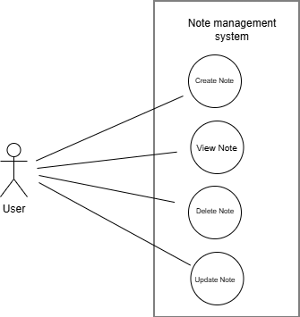
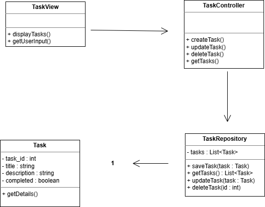
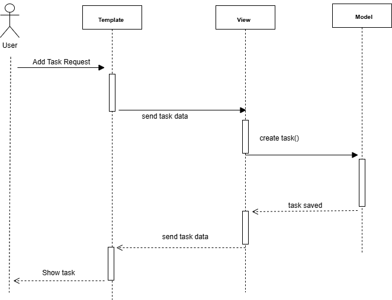

# Designing a Task Management System Through MVC and UML

**An architectural analysis of workflows, responsibilities and persistence boundaries**

**Amogelang R. Pelo**

## Abstract

I examine a software-design project that describes a task management system through Model–View–Controller (MVC) notes and six associated diagrams. The repository contains written design notes, a class diagram, a sequence diagram, a use-case diagram and additional drawings for CRUD operations and architecture. The diagrams describe a user who can create, read, update and delete task or note records; a controller that coordinates actions; a view that handles interaction; and a repository responsible for storing task objects. I assess the consistency of these artefacts, the responsibilities assigned to each component and the requirements that remain unspecified.

The strongest feature of the project is the attempt to communicate system behaviour using more than one perspective. The class diagram identifies `TaskView`, `TaskController`, `TaskRepository` and `Task`, while the sequence diagram depicts a task-creation interaction. However, the use-case diagram labels the system as *note management* rather than *task management*, and the sequence diagram uses `Template`, `View` and `Model` participants that do not fully match the class model. The notes also assign some storage operations directly to the controller, creating ambiguity about where application rules and persistence should reside. I conclude that the project is a credible introductory architecture exercise, but not evidence of an implemented or tested system.

**Keywords:** MVC; UML; software architecture; use cases; sequence diagram; CRUD; task repository; separation of concerns.

## 1. Introduction

Software architecture describes how a system is organised, how its parts interact and which constraints govern their responsibilities. For an application that manages tasks, even a simple create–read–update–delete (CRUD) workflow crosses several concerns: user input, validation, record identity, persistence, feedback and error handling. A design that assigns these responsibilities clearly is easier to understand and maintain than one where every function directly manipulates both the interface and the data store (Sommerville, 2016).

The source project uses MVC notes and Unified Modeling Language (UML)-style diagrams to plan a task management system. The README identifies the primary artefacts as written notes and six images, including an architecture graphic, class diagram, sequence diagram and use-case diagram. The notes describe a worker interacting with a view, selecting CRUD operations and sending requests through a controller, model and storage layer (Pelo, n.d.-a).

My research question is: **How coherently do the supplied diagrams define responsibilities and interactions for task management, and what would need to be specified before implementation and testing?** I evaluate the material as a design submission, not as source code or an executable product.

This distinction is important because a class diagram can illustrate intended structure without proving that classes have been implemented. Similarly, a sequence diagram expresses a possible interaction path, not a measurement of runtime calls or latency. I therefore distinguish architecture visible in the artefacts from extensions I recommend.

## 2. Conceptual framework

### 2.1 Model–View–Controller

MVC is an architectural separation of responsibilities in which the model represents application state and relevant rules, the view presents information to users, and a controller responds to interaction by coordinating the appropriate operations. MVC has different practical interpretations across desktop and web environments, so the important principle is an explicit, consistent allocation of responsibility rather than merely using three familiar labels (Fowler, 2002).

In a task system, the view might present a form and display task lists. The controller might interpret the request and invoke a service or model operation. The model would represent task data and state transitions, while a repository or data-access component would handle persistence. This separation can reduce coupling between user-interface code and storage details.

The source notes partially express this structure. They place the user at the view, describe the controller as handling CRUD actions and identify a model, database and file storage. However, phrases such as “controller sends data about the task to the database” overlap responsibilities that might instead belong behind a repository interface. Resolving this ambiguity is a design choice rather than a contradiction that can be settled by drawing arrows alone.

### 2.2 UML diagrams as complementary viewpoints

UML provides several diagram types for expressing distinct aspects of a system. A use-case diagram describes actor goals and system functions; a class diagram depicts important classes, operations and relationships; and a sequence diagram represents the temporal ordering of messages among participants (Object Management Group, 2017).

Each view answers a different question. The use-case diagram asks *what the user wants to accomplish*. The class model asks *which software abstractions exist and how they depend on one another*. The sequence diagram asks *how components collaborate during a particular action*. Consistency across these views makes a design more useful to developers and reviewers.

The diagrams do not need identical visual shapes, but their terminology and principal responsibilities should align. If a class diagram shows a controller coordinating repository operations, a sequence diagram of the same workflow should usually account for the controller or explicitly explain why it has been abstracted away.

### 2.3 CRUD and persistence

CRUD refers to creating, reading, updating and deleting records. These operations are conceptually simple, but their correct implementation depends on stable record identity, validation and consistent storage state. A repository abstraction can isolate these concerns from the user-facing interface and make it possible to replace an in-memory list or flat file with a database without redesigning every user interaction (Fowler, 2002).

For a task record, a unique identifier helps ensure that a request to update one task does not accidentally modify another. An explicit completion state can support transitions from incomplete to complete. The validity of such transitions should be defined independently of the visual screen or menu that requests them.

## 3. Research materials and assessment method

### 3.1 Material examined

I reviewed `MVC-notes.txt`, `MVC-original-notes.txt`, the README and the supplied diagrams, including `class-diagram.png`, `sequence-diagram.png`, `use-case-diagram.png` and `mvc-architecture.png`. The two text files present the same numbered description of the intended workflow. Their preservation suggests an original and portfolio record, but the inspected versions do not establish a documented evolution of the architecture (Pelo, n.d.-a; Pelo, n.d.-b).

| Artefact | Principal content | Intended design question |
|:--|:--|:--|
| MVC notes | Narrative of views, controller, model, API and storage | What responsibilities are intended? |
| Class diagram | `TaskView`, `TaskController`, `TaskRepository`, `Task` | Which abstractions should exist? |
| Use-case diagram | Create, view, update and delete a note | What can the user do? |
| Sequence diagram | Add-task request and save confirmation | How does one operation proceed? |
| Architecture image | Composite of structures and flows | How are viewpoints related? |
| CRUD diagram | Operations available for a Task entity | Which record operations are supported? |

### 3.2 Static design-review procedure

I compared the terms used in the notes against the class and interaction diagrams. I assessed the consistency of operations, the boundaries between presentation, control and persistence, and whether important workflow states were expressed. I also identified implementation questions that the current drawings leave unresolved, including record identity, validation, error messages, authorisation, storage failures and concurrency.

This is a **qualitative architecture review**, not a quantitative experiment. There are no execution traces, load tests, completed integration tests or user-study results supplied in this folder. I therefore do not infer achieved response times, security properties or production readiness.

## 4. Findings: functionality and structural design

### 4.1 User goals and use-case coverage

The use-case diagram shows a single actor labelled User connected to four operations: Create Note, View Note, Update Note and Delete Note. The overall box is labelled *Note management system*, although the repository and class diagram refer to task management. These are closely related CRUD workflows, but the discrepancy should be resolved so implementers know whether notes are distinct records or simply another term for tasks.

<figure><figcaption>Figure 1. Source use-case diagram showing one user and four note-management operations. The terminology should be reconciled with the task-related class model.</figcaption></figure>

The diagram communicates functional scope effectively at a high level. It does not define authentication, access permissions, ownership, task status or whether a user can update records created by another user. Nor does it specify validation and error cases. Those omissions are reasonable in a first draft but matter before implementation.

### 4.2 The class model

The class diagram identifies `TaskView` with `displayTasks()` and `getUserInput()`, and `TaskController` with `createTask()`, `updateTask()`, `deleteTask()` and `getTasks()`. It then connects the controller to a `TaskRepository`, which maintains `tasks: List<Task>` and operations such as `saveTask(task: Task)`, `getTasks()`, `updateTask(task: Task)` and `deleteTask(id: int)`.

The `Task` entity has `task_id: int`, `title: string`, `description: string` and `completed: boolean`, together with `getDetails()`. This is a concrete and appropriate starting point for a task model. The use of a task identifier distinguishes records and creates a basis for update/delete targeting.

<figure><figcaption>Figure 2. Supplied class diagram with four main abstractions. The diagram communicates proposed operations and dependencies but does not demonstrate implemented classes.</figcaption></figure>

The direction of dependencies is broadly consistent with an interface invoking a controller and the controller using storage operations. However, the diagram provides little information about error returns, access control or transaction semantics. Its `TaskRepository` attributes imply an in-memory list, while the narrative also mentions database and file storage. The intended persistence mechanism should be chosen or modelled behind an explicit interface.

### 4.3 Architectural responsibilities

The notes describe the user interacting with the view, which provides CRUD options. Input is forwarded to the controller. The controller performs actions, uses web APIs, sends data to a database and works with a model. The narrative then describes the database and file storage, and the model updating records when needed.

These descriptions demonstrate awareness of multiple architectural layers. Yet they blur some boundaries. In a conventional separation, the model or application service usually enforces task rules and the repository handles the storage operation. The controller should not have to know whether a task is persisted in a list, a file or a remote database.

A practical refinement would define a single interaction path: **User → View → Controller → Task service/model → Repository → Data store**, with responses returning in reverse order. External APIs would enter through a dedicated gateway only when an actual requirement demands them, rather than being inserted as a mandatory layer in every CRUD operation.

### 4.4 Sequence diagram and consistency

The supplied sequence diagram shows an Add Task Request travelling from User to Template, then to View and Model, followed by a task-saved response and return to the user. This depicts a high-level successful create operation. It does not show the `TaskController` or `TaskRepository` participants appearing in the class diagram.

<figure><figcaption>Figure 3. Supplied add-task sequence diagram. Its Template and Model participants do not map explicitly to the class diagram's controller and repository.</figcaption></figure>

The inconsistency is correctable. I would give the participants names matching the class diagram and explicitly show `createTask`, model validation, `saveTask`, persistence acknowledgement and the resulting view update. Error cases should appear as alternate branches or separate scenarios.

## 5. Critical design assessment

### 5.1 Separation of concerns

The project recognises the view, controller and model as separate concepts, which is a useful starting point. The class diagram goes further by introducing a repository abstraction. I regard that repository as one of the strongest design choices because it creates a potential boundary between application behaviour and the technology used to save records.

The main weakness is that the notes and sequence diagrams do not consistently use those boundaries. The controller is assigned both domain actions and direct data-storage operations, while the model also appears to update stored tasks. Unless the architecture clarifies who owns validation and persistence, different developers could implement overlapping logic.

### 5.2 State transitions and record identity

The `Task` model contains a completion flag but does not specify the operations that change it. Is completing a task a special case of `updateTask`? Can a completed task be reopened? Are deleted tasks permanently erased, archived or soft-deleted? Is the identifier generated by the controller, repository or data store?

These questions are not merely implementation details. They affect invariants such as “an update to task 17 must not change task 18” and “a deleted task must not appear in an active task list.” I would define those invariants as part of the domain model and verify them through tests.

### 5.3 Validation and authorisation

The design has one generic user and no ownership rule. In a multi-user task service, that would leave open whether any user can modify any task. An authenticated user identity and authorisation rule would be needed for realistic collaboration. In a single-user offline tool, those requirements may be intentionally out of scope, but the scope should be stated.

Input validation should include the maximum permitted title length, required fields, handling of blank descriptions and a policy for task identifiers. The design should also account for failed repository operations and present a coherent error to the user instead of silently reporting success.

### 5.4 Storage consistency and durability

The notes refer to database storage, file storage and RAM in the same workflow. These mechanisms can coexist, but they have different roles. RAM can hold transient objects; file storage provides persistence; and a database can structure durable records and enforce constraints. The diagram should not suggest that all three are interchangeable.

If the system uses an in-memory `List<Task>`, state may disappear when the program exits unless a persistence strategy exists. If it writes to a file, the design needs to address malformed records and partial writes. If it uses a database, it should define the task table and update transactions. None of these choices has been demonstrated as implemented in this design-only folder.

## 6. Proposed architecture refinement

### 6.1 Responsibilities by component

I would retain the four principal classes but state their responsibilities more narrowly.

| Component | Recommended responsibility | Should not own |
|:--|:--|:--|
| `TaskView` | Input capture, messages and task display | Database calls |
| `TaskController` | Request routing and response coordination | Persistence implementation details |
| `Task` / task service | Validation and state transitions | User-interface formatting |
| `TaskRepository` | Read/write operations keyed by task ID | User prompts |
| Data store | Durable records and constraints | Task-specific presentation |

This allocation preserves the intention visible in the class diagram while reducing the ambiguities in the written notes. It also creates clearer seams for unit and integration testing.

### 6.2 A more complete create-task scenario

A refined create scenario would proceed as follows. The user submits a title and description through the view. The controller builds a request and invokes the task service, which validates required fields and creates a task entity. The repository persists the task and returns a generated identifier or an explicit failure. The controller then sends a structured result to the view for display.

The corresponding sequence diagram should show both success and failure paths. If validation rejects an empty title, the repository should not be invoked. If storage fails, the view should not claim the task was saved. These are proposed acceptance conditions, not claims that they are enforced by existing software.

### 6.3 Suggested acceptance tests

| Scenario | Required result |
|:--|:--|
| Create a task with valid fields | Record saved and task ID returned |
| Create a task without a title | Validation error; no record created |
| Read an existing task | Correct task displayed |
| Update one task | Only the selected ID changes |
| Delete a task | Record removed or marked deleted by documented policy |
| Update an unknown task ID | Explicit not-found result |
| Storage operation fails | Error shown; no false success message |
| User lacks ownership, if multi-user | Update/delete rejected |

The proposed tests would translate the diagrams' broad intentions into verifiable behaviour. They have not been executed as part of this document because the inspected folder contains design artefacts, not an application implementation.

### 6.4 Documentation consistency

I would use a single name, such as *Task Management System*, across the README and diagrams. If notes are a separate entity, that relationship should be modelled explicitly rather than handled through inconsistent terminology. I would also choose one definition of MVC participants and reflect it across the use-case, class and sequence diagrams.

Keeping the artefacts aligned would make it easier to implement the system and review whether code corresponds to the intended architecture. The diagrams should be versioned with clear links between related scenarios and classes.

## 7. Limitations and conclusion

### 7.1 Study limitations

This paper assesses the contents of one repository folder containing text notes and diagrams. It does not inspect an executable implementation of the specific design, and it cannot verify runtime behaviour, data durability, response times or security. The critique is architectural: it examines consistency, completeness and responsibility boundaries rather than measured performance.

The notes and diagrams may have been produced as stages of an educational assignment, which could explain why some participants or names differ. I do not infer that the discrepancies were present in a deployed application.

### 7.2 Conclusion

I find that the project demonstrates meaningful introductory software-design concepts: identifying user CRUD operations, assigning controller and view responsibilities, representing a task entity and describing workflow interactions through diagrams. The class diagram's `TaskRepository` is a particularly useful abstraction because it separates persistence operations from the interface.

The principal improvements involve consistent naming, clearer ownership of validation and persistence, alignment between class and sequence diagrams, and explicit handling of failed operations and record identity. I would preserve the project as evidence of architectural reasoning while distinguishing it from an implemented system.

A stronger next version would convert the design into a small tested prototype and verify that the same operations appear consistently across use cases, methods, sequence messages and persisted records. This would move the work from a collection of related diagrams toward a coherent, testable architecture.

## References

Bass, L., Clements, P. and Kazman, R. (2021) *Software Architecture in Practice*. 4th edn. Boston: Addison-Wesley.

Fowler, M. (2002) *Patterns of Enterprise Application Architecture*. Boston: Addison-Wesley.

Object Management Group (2017) *OMG Unified Modeling Language (OMG UML), Version 2.5.1*. Available at: https://www.omg.org/spec/UML/2.5.1/.

Pelo, A.R. (n.d.-a) *Modelling a task management system: MVC notes and design diagrams*. GitHub portfolio. Available at: https://github.com/amopelo-southafrica/Software-Engineering-/tree/main/Software-Architecture-and-Design/modelling-a-task-management-system.

Pelo, A.R. (n.d.-b) *MVC-notes.txt*. GitHub portfolio. Available at: https://github.com/amopelo-southafrica/Software-Engineering-/blob/main/Software-Architecture-and-Design/modelling-a-task-management-system/MVC-notes.txt.

Sommerville, I. (2016) *Software Engineering*. 10th edn. Boston: Pearson.
