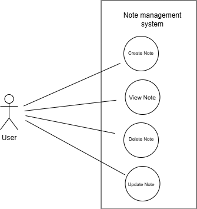
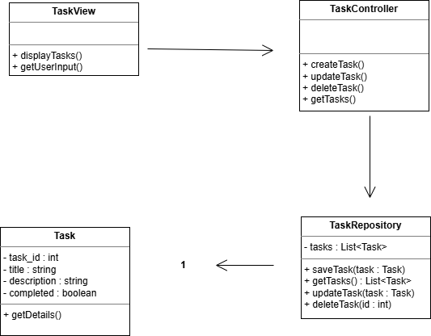
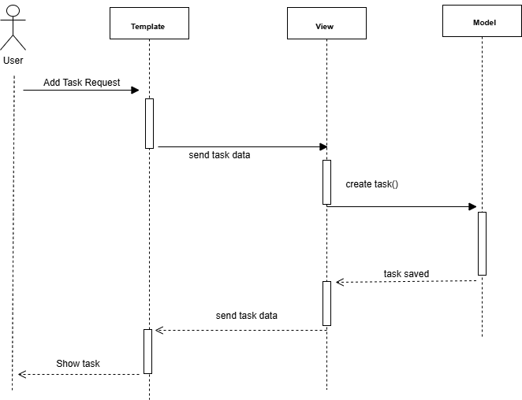
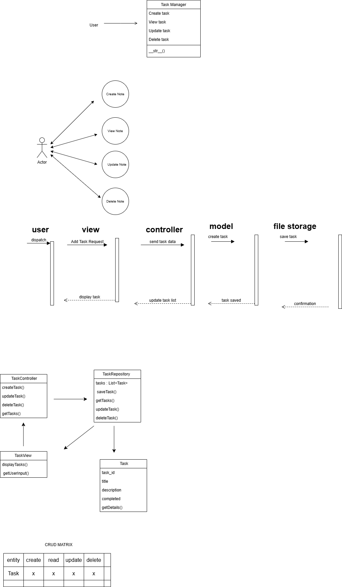
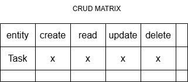
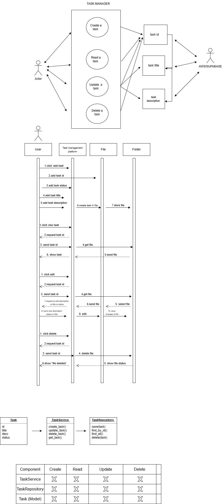

# Task Management System — Software Design

## What this project is about

I developed a collection of software-design diagrams to explore how a task-management application could be structured. I modelled the interactions between users, task operations, the application interface, its logic and the data layer.

## What I designed

- **Use-case diagram:** users and the actions they perform in the proposed system.
- **Class diagram:** the proposed application's objects and their relationships.
- **Sequence diagram:** an interaction flow between participating components.
- **Model–View–Controller diagram:** responsibility boundaries between the interface, controller, model, data storage and external API interactions.
- **CRUD diagram and supporting diagram:** additional visual explorations of the design.

The diagrams describe my proposed system architecture and interaction flows; they are separate from the implementation.

## Design diagrams

### Use cases

### Class structure

### Sequence of interactions

### Model–View–Controller architecture

### CRUD operations

### Additional diagram

## Supporting notes

The [MVC component notes](MVC-notes.txt) describe the worker interacting with the view, a controller processing the chosen action, a model handling updates, and database/API components supporting the task workflow.

## Tools and methods

System decomposition, UML-style class and sequence diagrams, use-case analysis, MVC architectural patterns, and CRUD workflow design. I prepared the diagrams as part of my software-design coursework.

